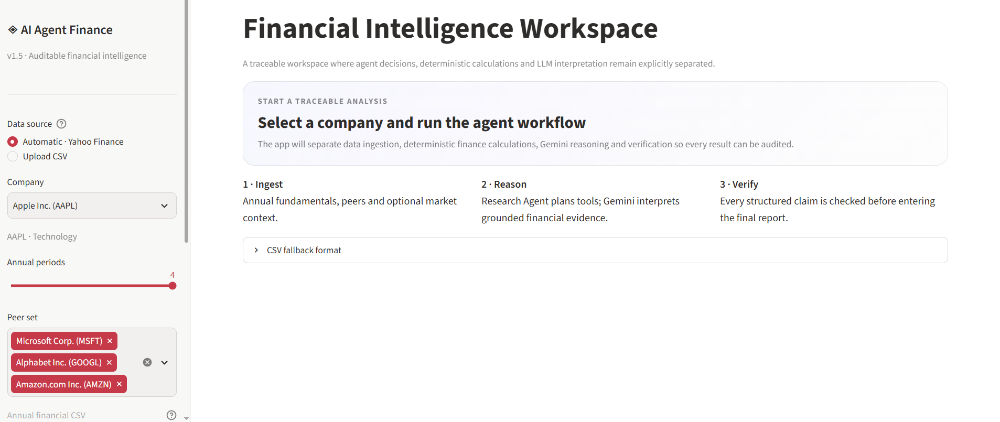
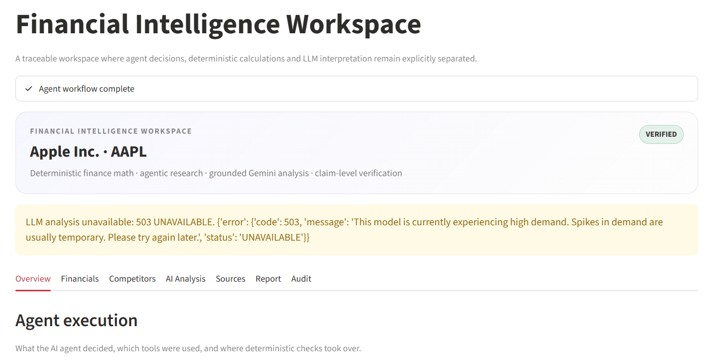
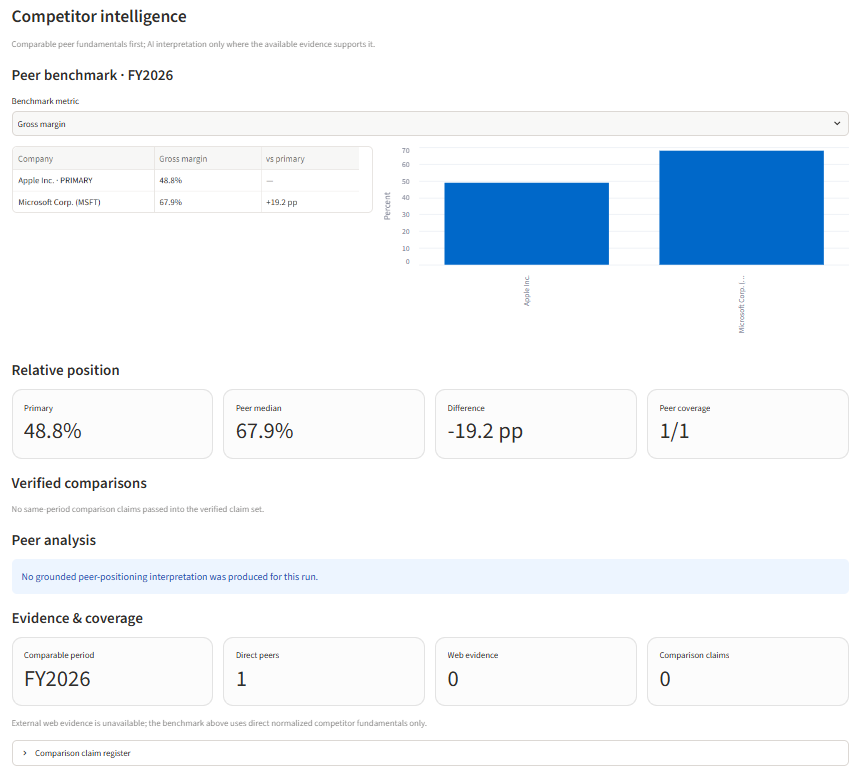
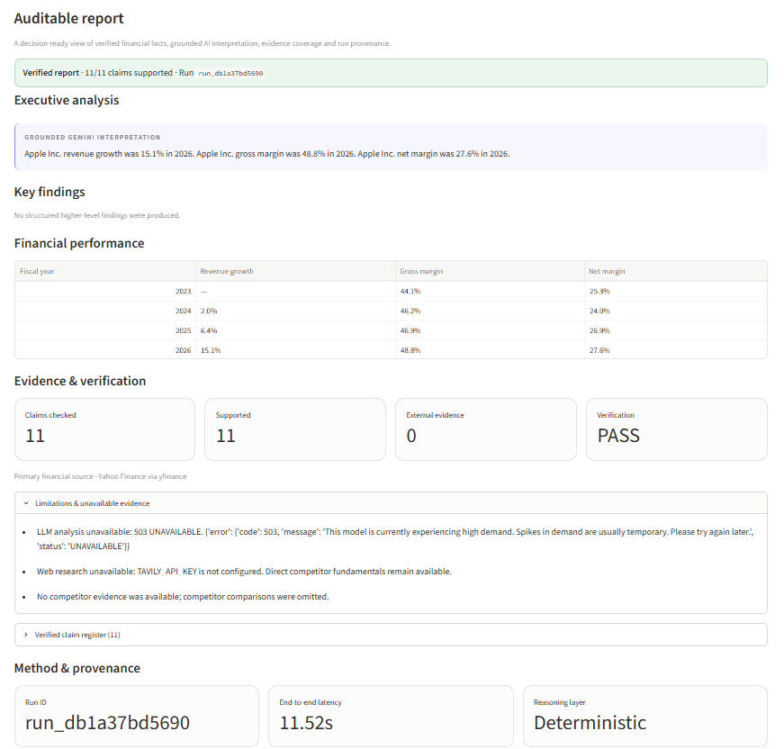

# Auditable Agentic Financial Intelligence

A financial analysis system built around one core principle: **the LLM should not be the calculator or the source of truth.**

The application retrieves company fundamentals, calculates financial metrics using Python, gathers supporting evidence, uses Gemini for financial interpretation, and verifies structured claims before presenting results.

**LangGraph** orchestrates the workflow, while **Streamlit** provides the user interface.

## UI

<!-- Add screenshots under docs/images/ -->

<p align="center">
  
  
</p>

<p align="center">
  
  
</p>

## What It Does

The system transforms company financial statements and supporting evidence into an auditable financial analysis report.

### Workflow

```text
Ingest
  ↓
Validate
  ↓
Calculate
  ↓
Research
  ↓
Analyze
  ↓
Gemini Interpretation
  ↓
Verify
  ↓
Report
```

Financial calculations are performed deterministically in Python. Gemini interprets calculated metrics and collected evidence rather than independently calculating financial ratios.

If a generated claim fails verification, the workflow can enter a bounded revision cycle instead of silently accepting unsupported output.

## Features

- Automatic annual financial data ingestion using Yahoo Finance (`yfinance`)
- CSV upload as an alternative data source
- Revenue growth, gross margin, and net margin calculations
- Automatic competitor fundamentals ingestion
- Same-period peer comparison
- Optional web research through Tavily
- Recent market data and news context
- Gemini-based financial interpretation
- Structured claims with calculation and evidence references
- Deterministic claim verification
- Bounded claim revision
- Run-level logging and observability
- Evaluation of numerical correctness, evidence coverage, and unsupported claims
- Downloadable auditable Markdown reports
- Streamlit dashboard for financials, competitors, AI analysis, sources, and audit details

## Architecture

The project separates data ingestion, deterministic computation, reasoning, and verification.

```text
              ┌─────────────────────┐
              │   Data Ingestion    │
              │ Yahoo / CSV / News  │
              └──────────┬──────────┘
                         │
                         ▼
              ┌─────────────────────┐
              │ Validation + Metrics│
              │ Deterministic Python│
              └──────────┬──────────┘
                         │
             ┌───────────┴───────────┐
             ▼                       ▼
    ┌─────────────────┐     ┌─────────────────┐
    │ Research Layer  │     │ Financial State │
    │ Evidence/Sources│     │ Metrics + Refs  │
    └────────┬────────┘     └────────┬────────┘
             └───────────┬───────────┘
                         ▼
              ┌─────────────────────┐
              │   Analysis Agent    │
              │       Gemini        │
              └──────────┬──────────┘
                         ▼
              ┌─────────────────────┐
              │ Verification Engine │
              │ Claims / Provenance │
              └──────────┬──────────┘
                         │
                    Pass / Revise
                         │
                         ▼
              ┌─────────────────────┐
              │ Report + Streamlit  │
              └─────────────────────┘
```

### Why This Separation?

A financial metric such as gross margin does not require an LLM:

```python
gross_margin = gross_profit / revenue
```

Using an LLM for deterministic calculations would make the process slower, more expensive, and harder to verify.

Instead, the model handles tasks where language reasoning is valuable:

- Identifying financial trends
- Summarizing company performance
- Interpreting financial indicators
- Explaining verified peer comparisons

## Agent and Tool Boundaries

Not every component is an agent.

- **Tools and Services:** `YahooFinanceProvider`, news scraper, and financial calculator retrieve or transform data deterministically.
- **Analysis Agent:** Consumes structured metrics and evidence, generates analytical claims, and participates in revision when verification fails.
- **LangGraph:** Coordinates workflow transitions and maintains shared execution state.

## Grounding and Verification

Generated claims are maintained separately from narrative text.

A claim can reference a deterministic calculation:

```text
metrics[2025].gross_margin
```

Or an external evidence object collected during research.

The verification layer checks structured claims before report generation.

The system distinguishes between:

| Information Type | Description |
|---|---|
| Calculated Fact | Produced by deterministic Python calculations |
| External Fact | Retrieved from an external source |
| LLM Interpretation | Generated using verified metrics and evidence |
| Unsupported Statement | A claim without sufficient supporting evidence |

Peer comparisons are restricted to comparable fiscal periods. If companies do not share a common reporting period, the application does not silently compare values from different years.

## Application Pages

| Page | Description |
|---|---|
| **Overview** | Execution path, financial metrics, historical trends, and reliability information |
| **Financials** | Normalized financial metrics and margin history |
| **Competitors** | Same-period peer benchmarking and grounded competitor interpretation |
| **AI Analysis** | Higher-level financial interpretation based on verified claims |
| **Sources** | Collected evidence and data-source information |
| **Report** | Auditable financial report generated from verified workflow state |
| **Audit** | Verification results, data lineage, tool plans, claims, evidence, and LLM usage |

## Project Structure

```text
02. Auditable Agentic Financial Intelligence/
│
├── app/
│   ├── agents/
│   ├── graph/
│   ├── schemas/
│   ├── services/
│   └── tools/
│
├── data/
│   ├── runs/
│   └── samples/
│
├── evaluation/
│   ├── datasets/
│   └── results/
│
├── tests/
│
├── streamlit_app.py
├── requirements.txt
├── pytest.ini
├── .env.example
└── README.md
```

## Setup

### 1. Clone the Repository

```bash
git clone <repository-url>
cd "02. Auditable Agentic Financial Intelligence"
```

### 2. Create a Virtual Environment

```bash
python -m venv .venv
```

Activate it on Windows:

```powershell
.venv\Scripts\Activate.ps1
```

### 3. Install Dependencies

```bash
pip install -r requirements.txt
```

### 4. Configure Environment Variables

Set your Gemini API key:

```powershell
$env:GEMINI_API_KEY="your-key"
```

Web research is optional. To enable Tavily:

```powershell
$env:TAVILY_API_KEY="your-key"
```

### 5. Run the Application

```bash
streamlit run streamlit_app.py
```

Without Tavily, company and competitor fundamentals can still be retrieved. The application reports missing external research evidence instead of treating it as available.

## Tests

Run the test suite:

```bash
pytest -q
```

Tests cover:

- Deterministic financial calculations
- LLM grounding constraints
- Claim reference validation
- Peer evidence requirements
- Workflow execution and verification

An AI insight cannot become supported simply by referencing a nonexistent claim ID. Peer-positioning output also requires supporting peer evidence.

## Data and Model Notes

- **yfinance:** Used as a convenient financial data ingestion source. It is not treated as an authoritative regulatory filing source.
- **Gemini:** Used for financial reasoning and interpretation. Model outputs are constrained by structured inputs and followed by verification, but generated interpretations are not guaranteed to be infallible.
- **Tavily:** Provides optional external web research and supporting evidence.

> This project is an engineering demonstration of auditable agentic financial analysis, not investment advice.

## Future Improvements

Potential extensions include:

- Primary-source financial ingestion using SEC filings
- Expanded deterministic financial metric library
- Larger fixed evaluation datasets
- End-to-end regression testing
- More comprehensive evidence validation

The central design principle will remain unchanged:

**New model capabilities should never weaken the boundary between retrieved facts, deterministic calculations, and generated interpretations.**
